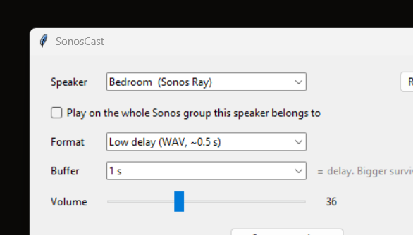

# SonosCast

Play whatever your Windows laptop is playing on a Sonos speaker, over WiFi,
with about a second of delay.

Sonos Ray, Beam, Arc, Five and One have no Bluetooth receiver, so Bluetooth
can't do this. SonosCast does what Sonos actually supports: it captures the
laptop's default audio output, serves it as an audio stream on your home
network, and tells the speaker to tune in.



## Download

Grab `SonosCast-share.zip` from the
[latest release](https://github.com/mgcolby/SonosCast/releases/latest),
unzip, double-click `SonosCast.exe`. Windows 10/11, no install, no Python.

Two one-time Windows prompts on first run:

- **SmartScreen** "unknown publisher": choose "More info", then "Run anyway".
  The exe is unsigned; build it yourself from source if you prefer.
- **Windows Defender Firewall** "allow this app to communicate": tick
  **Private networks** and click **Allow access**. The speaker fetches the
  audio *from* the laptop, so if this is blocked the Sonos never connects and
  the status sits on TRANSITIONING forever. Clicked Cancel by mistake? Windows
  Security > Firewall & network protection > Allow an app through firewall >
  tick SonosCast for Private.

## Use

1. Pick a speaker from the dropdown (Rescan if one is missing).
2. Tick the group box if every speaker grouped with it should play too.
3. Leave Format on **Low delay (WAV)** and Buffer on **1 s**. Press
   **Start streaming**. Sound starts in about a second.
4. The Volume slider controls the Sonos volume.
5. **Stop streaming** or closing the window stops the speaker.

## Delay and dropouts

The laptop side adds under 100 ms. The delay you hear is audio sitting in the
Sonos player's buffer, and you choose how much:

| Format | Buffer setting | Delay you hear | Use when |
| --- | --- | --- | --- |
| Low delay (WAV) | 0.3 to 3 s, default 1 s | = the buffer | Default. The buffer is your cushion against WiFi hiccups: 1 s survives a 1 s hiccup. |
| Robust (MP3) | fixed by Sonos | ~5 s | WAV breaks up even at 3 s, or a weak/busy WiFi. |

Breaking up? Stop, raise Buffer one step, Start. If the speaker stops on its
own, SonosCast restarts the stream automatically.

Lip sync for video is not possible over WiFi; the Sonos is always behind. For
local files, VLC and mpv can run audio ahead of video by the buffer amount.
For perfect sync use the speaker's optical input with a USB-to-optical adapter.

## Things to know

- Laptop and Sonos must be on the same network. A VPN on the laptop is fine.
- The laptop's own speakers keep playing too. Turn them down; whether muting
  also mutes the stream depends on the sound driver, so try it.
- Silence on the Sonos almost always means silence from the source: a muted
  browser tab keeps an "active" audio session while sending nothing.
- It follows the laptop's *default* output device at the moment you press
  Start. Switch devices in Windows, then Stop and Start again.
- Two copies on one network each pick their own port automatically.
- `sonoscast.log` next to the exe records every status and speaker state
  change. Read it first when something misbehaves.

## How it works

```
WASAPI loopback (default output)  ->  pacer (exactly real time, silence when idle)
   ->  WAV header + PCM, or MP3 (LAME)  ->  HTTP server on the laptop (port 5555+)
   ->  Sonos AVTransport.SetAVTransportURI + Play (via SoCo)  ->  speaker pulls the stream
```

Things learned the hard way, all measured on Sonos Rays and baked into the code:

- **Windows delivers no loopback audio while nothing is playing.** The pacer
  synthesises silence on a wall clock so the stream is always exactly real
  time. Under-delivering by even 25 % makes the Sonos starve and rebuffer.
- **Sonos buffers by stream type.** A plain `http://` WAV "file" starts in
  ~0.5 s with ~0.3 s buffered. An `x-rincon-mp3radio://` stream holds ~5 s and
  gates on both wall time and bytes. MP3 over plain `http://` still gets the
  5 s treatment.
- **Prefilling silence sets the cushion.** For WAV, N seconds of silence sent
  on connect makes the Sonos hold exactly N seconds, and it stays inside the
  speaker rather than piling up on the laptop. For MP3 radio, a 2 s prefill
  cuts the start wait from 5.5 s to 3 s without changing the delay.
- **Bind strictly.** Windows lets two processes bind the same port with
  `SO_REUSEADDR` and silently splits connections between them.

## Run or build from source

Python 3.11+ on Windows.

```
py -3.11 -m venv .venv
.venv\Scripts\pip install -r requirements-dev.txt
.venv\Scripts\python sonoscast.py                            # GUI
.venv\Scripts\python sonoscast.py --selftest Kitchen wav     # 10 s headless probe against a speaker
set SONOSCAST_DEBUG=1                                         # log every HTTP connection
build.bat                                                     # PyInstaller -> dist\SonosCast.exe + dist\SonosCast-share.zip
```

The self-test prints how many seconds of audio the speaker had pulled when it
reported PLAYING, which is the delay you'll hear, then a per-second timeline of
sent versus expected audio.

## Contributing

Issues and pull requests welcome. Useful things to add: a macOS or Linux
capture backend (everything but `AudioBroadcaster._capture_loop` is portable),
a tray icon, FLAC for lower bandwidth at low delay.

## License

MIT, see `LICENSE`. Third-party packages and their licenses are listed in
`THIRD_PARTY_NOTICES.md`. Sonos is a trademark of Sonos, Inc.; this project is
not affiliated with Sonos.
